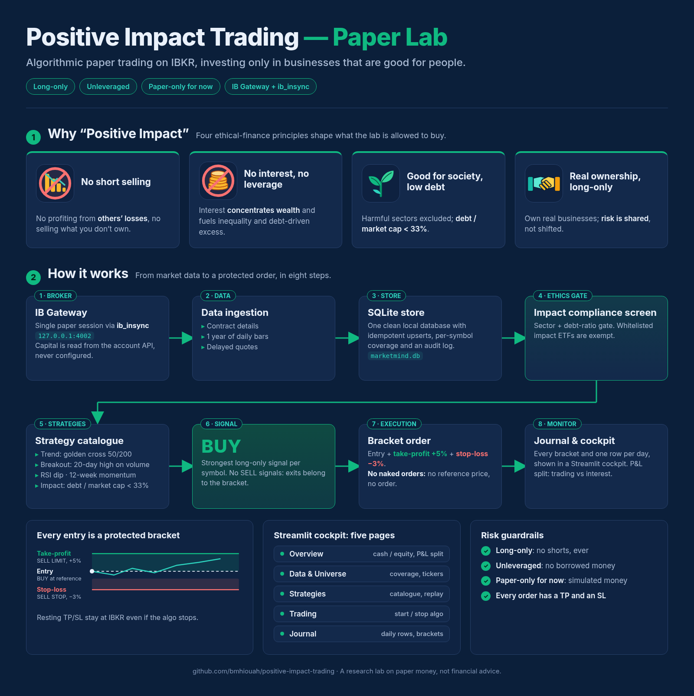

# Positive Impact Trading — Paper Lab

<p align="center"></p>

A deliberately small platform to **experiment with algorithmic paper trading**.
Everything here is long-only, unleveraged and paper-only. When the project is
mature, the same ideas can be carried over to real trading.

The lab is built around what the **IB Gateway API actually provides**: it pulls
contract metadata, daily OHLCV history and delayed quotes, organises them into
one clean SQLite store, and only then lets long-only strategies run. Strategies
declare the data they need, so the tool shows what is possible *with the data
you really have* instead of pretending.

Technical details: [`docs/ARCHITECTURE.md`](docs/ARCHITECTURE.md). Product
decisions and operator constraints (pipeline priority, file-driven target,
France / IBKR context, eligibility filters, cockpit UX):
[`docs/DECISIONS.md`](docs/DECISIONS.md). The original AI-research-platform
vision is kept (for context only) in
[`docs/archive/`](docs/archive/README.md).

## What it does

* Connects to **one** IB Gateway paper session and starts the algo on demand.
* Reads **capital from the IBKR account via the API** — it is never a setting.
* Gathers **contract details, 1 year of daily bars and delayed quotes** for the
  active universe, with idempotent upserts and a per-symbol audit log.
* Records the **original paper money once**, then one clean row per day.
* Separates **trading P&L from interest/fees**, so a flat account earning
  interest on idle cash never looks like a phantom trade.
* Shows a **cash vs long-equity donut** on the first page.
* Offers a **data-driven catalogue of long-only strategies** plus a historical
  rule replay; only strategies the stored data can support are runnable.
* Sends **every entry as a TP/SL bracket** — no naked orders, ever.
* Keeps the **universe in a table**: add a ticker in the UI and ingestion,
  coverage, strategies and the runner all pick it up. No code change.

## There is nothing to configure

| | Value |
|---|---|
| Gateway | `127.0.0.1:4002` (paper) |
| Client id | `1` — one connection at a time |
| Market data | delayed (type 3) |
| Take profit / stop loss | `+5%` / `−3%` from the reference price |
| History | `1 Y` of `1 day` bars |
| Journal | `data/marketmind.db` |

All of these are plain constants in `marketmind/config.py`. Host, port, client
id, capital and live/paper mode are **not** parameters, environment variables or
UI inputs. There is no `.env`: nothing in the code reads one.

Prerequisites: IB Gateway running and logged into the paper account, with
`Configure > API > Settings > Enable ActiveX and Socket Clients`, and no other
client occupying client id 1.

## Running it

```bash
# Cockpit (Trading is the first page)
python scripts/run_cockpit.py                 # or: streamlit run marketmind/cockpit/app.py

# Bot on its own (Ctrl+C to stop)
python -m marketmind.live_trading --interval 60   # or the installed `run-bot` script

# Morning one-click (macOS): Gateway if needed + cockpit + open browser
# Does not Start Algo — that stays a cockpit click.
./scripts/start_trading_morning.sh
./scripts/install_desktop_launcher.sh   # once → Desktop “Positive Impact Trading.command”
```

Use the project interpreter — the default `python3` has no `ib_insync`:

```bash
/Users/badremhiouah/miniconda3/envs/py314/bin/python scripts/run_cockpit.py
```

### The daily routine

1. **🧪 Strategies → Sync from IBKR.** One short-lived session pulls contract
   metadata, daily bars and delayed quotes for every active ticker, refreshes
   the account snapshot and writes the journal row. Do this once a day.
2. **📈 Trading → Start algo.** Connects first, reads capital from the API,
   writes the baseline and the day row, then starts the loop. The first cycle
   also refreshes stale data **over that same connection**. Open positions and
   orders sent this session stay on this page.
3. **📒 Journal.** How the paper capital moved, trading separated from interest,
   and every bracket grouped by stock.

Only one connection may exist at a time: manual sync and Read account are
disabled while the algo is running, and the runner does its own refresh
instead. Stopping the algo leaves resting TP/SL brackets at IBKR, so open
positions stay protected.

## The three pages

| Page | What it is for |
|---|---|
| **📈 Trading** | Start and stop the algo, read the account, see open positions and the orders as they go out |
| **🧪 Strategies** | The rules, what each one still needs, the universe, debt ratios and price history |
| **📒 Journal** | How the capital moved, orders by stock, a rule replay on past bars, and the daily rows |

## Data and strategies

`marketmind/market_data.py` orchestrates one pass over the universe:
`reqContractDetails` → `reqHistoricalData` → delayed `reqMktData`, writing to
`contracts` / `instruments`, `price_bars` and `market_quotes`. Bars are upserted,
so repeated syncs never duplicate history. `coverage()` reports one row per
active instrument with bar count, freshness, quote, fundamentals and status
(`ready` / `partial` / `empty`).

IBKR **refuses `reqFundamentalData` on this paper account (error 10358)**, so
debt-to-market-cap ratios and excluded sectors are entered from **Strategies →
Debt ratios and sectors**. They go into the same `fundamental_data` table the
compliance gate reads — there is no parallel source of truth. Whitelisted impact
ETFs are exempt.

The algo sends one rule at a time. The incumbent, from `marketmind/momentum.py`,
buys when the stock's own return from 12 months ago to 1 month ago is positive.
The stop starts two 20-day average ranges under the entry and then follows the
highest close since the entry. It never moves down, and there is no take-profit.
Each buy risks 0.5% of net liquidation. A stop-out does not buy the name again
until that reading has turned off and come back. The decision runs once per
New York session, on the last completed daily bar.

`marketmind/contest.py` may replace that incumbent. It tries a short grid —
six entries, four stop distances, a trailing stop or a target at two or three
times the risk, and an optional 63-session time limit — on the stored daily
bars. The favorite is chosen on the earlier part of the history. It becomes
the live rule only when the later part, which the choice did not see, made
more money than the incumbent. Until the bars cover about two years, the
incumbent keeps trading. A bar that touches both the stop and the target
counts as the stop. Five basis points of cost are charged each way.

History is five years of daily bars, because the signal needs one year and a
check on what came before needs more.

`marketmind/strategy_catalog.py` still declares the other long-only rules so
they can be studied. The runner does not send them.

| Key | Rule | Sent by the algo | Needs |
|---|---|---|---|
| `momentum` | 12-month return, skipping the last month | yes | 253 daily bars |
| `trend` | Golden cross 50/200 | no | 200 daily bars |
| `breakout` | 20-day high on above-average volume | no | 21 bars |
| `dip` | RSI washout while above SMA50 | no | 50 bars |
| `impact_debt` | Compliant sector and debt/MCap < 33% | no — this is the screen, not a buy | debt ratio |

`replay()` walks a rule over past bars using only data available at each date
(a rule replay, **not** a full backtest).

## The journal

`marketmind/journal.py` owns three tables:

| Table | Contents |
|---|---|
| `paper_baseline` | one immutable row: original capital / cash / equity / currency, from the API |
| `paper_daily` | one upserted row per UTC day: net liquidation, cash, equity, total change, trading P&L, interest, accrued cash, currency, order count |
| `paper_orders` | every entry that was sent. Outcome stays open until the stop fills or the momentum exit fills. Refusals are not stored |

`record()` runs on every trading cycle, so it writes *only* to `paper_daily`
and never appends to legacy `account_snapshots` / `portfolio_equity`.

Equity = `GrossPositionValue`; cash = `NetLiquidation − equity`. The residual
between `NetLiquidation` and `TotalCashValue` on a flat account is **accrued
interest**, not a stock position. A legacy database is migrated in place: the
residual `pnl_vs_original − trading_pnl` is backfilled into `interest_pnl`, so
old rows never claim the change came from trading.

## Orders

Every submitted entry is a buy plus a GTC stop, built in
`marketmind/broker/ib_adapter.py`:

```
BUY parent (market or limit, transmit=False, GTC)
  └─ SELL STOP  two average ranges under the entry   (parentId, transmit=True, GTC)
```

There is no take-profit. The stop is good-til-cancelled because the position
is held for weeks. `ref` is the bid/ask mid (falling back to last / close).
If no reference price can be obtained, or the stop is not strictly below it,
submission **fails instead of sending an unprotected order**. Both legs are
sanitised for the Gateway v151 `EtradeOnly` rejection (error 10268). Orders
still pass through the `ImpactExecutionEngine` compliance gate. When the
12-month reading turns flat, or the close falls through the trailed stop, the
runner cancels the stop and sells the shares. Stopping the algo leaves the
stop resting at IBKR.

## Project layout

```
README.md                       this guide
docs/ARCHITECTURE.md            module map, lifecycle, data and order design
docs/DECISIONS.md               product decisions and operator constraints
docs/archive/                   pre-MVP vision documents (not runtime code)
marketmind/
  config.py                     fixed constants — the only place to change the session
  ib_compat.py                  Python 3.13+ event-loop bootstrap for ib_insync
  broker/ib_adapter.py          the single IBKR session + bracket builder
  compliance/                   ImpactExecutionEngine gate + whitelists
  universe.py                   instruments table: the scalable universe
  market_data.py                IBKR ingestion, coverage, manual fundamentals
  momentum.py                   incumbent book: 12-1 signal, ATR stop, size
  contest.py                    walk-forward grid that may replace the incumbent
  strategy_catalog.py           study rules, and replay
  journal.py                    paper_baseline / paper_daily / paper_orders
  data/                         SQLite store + typed models
  live_trading.py               LiveTradingRunner + CLI entry point
  cockpit/
    app.py                      three pages: Trading, Strategies, Journal
    theme.py                    shared visual system
    state.py                    process-wide runner state, refresh, data sync
    tabs/                       overview · data_lab · strategies · trading · journal
scripts/
  run_cockpit.py                the one cockpit launcher
  ib_connection_probe.py        standalone connect → disconnect → reconnect + bracket test
tests/                          unit tests + opt-in live Gateway integration tests
data/                           local journal DB (git-ignored, created on first run)
```

## Architecture note

The whole `ib_insync` session (connect, data, orders, disconnect) is owned by
**one dedicated event-loop thread**. All public adapter methods are synchronous
and thread-safe, so Streamlit's script thread never manages an asyncio loop.
`connect()` always disconnects first; graceful `IB.disconnect()` frees client
id 1 for the next run.

## Verifying

```bash
PY=/Users/badremhiouah/miniconda3/envs/py314/bin/python   # project environment

$PY scripts/ib_connection_probe.py            # connect -> disconnect -> reconnect
$PY scripts/ib_connection_probe.py --all      # + data + TP/SL bracket round trip
$PY -m pytest tests/                          # unit tests, no Gateway needed
MARKETMIND_IB_INTEGRATION=1 $PY -m pytest tests/test_ib_adapter.py  # live Gateway
```

The probe places a deliberately unfillable 1-share bracket, confirms IB
acknowledges it, cancels all three legs and disconnects. No position is opened.

In this workspace, keep pytest's temp dirs inside the project — the sandbox
brokers filesystem calls under `/private/var/...` and can raise `EEXIST` /
`ENOENT` when `mkdir` hits an existing or missing parent:

```bash
T="$PWD/.workbuddy-ai/tmp/run-$(date +%s)" && mkdir -p "$T"
TMPDIR="$T" $PY -m pytest tests/
```

## Current state

Connection, account reads, Start/Stop Algo, the honest P&L split, the clean
journal, the scalable data layer, the strategy catalogue and the five-page
cockpit are implemented and unit-tested. Bracket placement is verified against a
live paper Gateway with the standalone probe.

The local journal currently holds the original paper money and two daily rows,
with **no trades**: the +56.45 change is accrued interest on idle cash, not a
trading gain. Run a data sync to populate `price_bars` before the strategies can
produce entries, and supply debt ratios in Compliance data before the impact
screen will allow an equity order.
