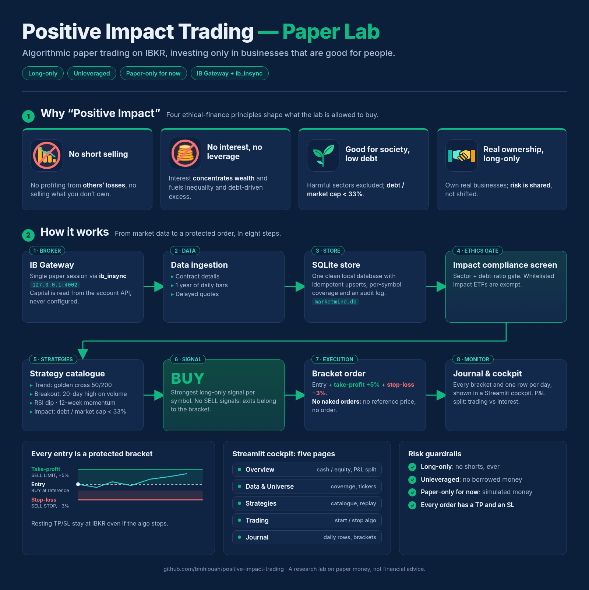

# Positive Impact Trading — Paper Lab

<p align="center"></p>

A deliberately small platform to **experiment with algorithmic paper trading**.
Everything here is long-only, unleveraged and paper-only. When the project is
mature, the same ideas can be carried over to real trading.

The lab is built around what the **IB Gateway API actually provides**: it pulls
contract metadata, daily OHLCV history and delayed quotes, organises them into
one clean SQLite store, and only then lets long-only strategies run. Strategies
declare the data they need, so the tool shows what is possible *with the data
you really have* instead of pretending.

Technical details: [`docs/ARCHITECTURE.md`](docs/ARCHITECTURE.md). The original
AI-research-platform vision is kept (for context only) in
[`docs/archive/`](docs/archive/README.md).

## What it does

* Connects to **one** IB Gateway paper session and starts the algo on demand.
* Reads **capital from the IBKR account via the API** — it is never a setting.
* Gathers **contract details, 1 year of daily bars and delayed quotes** for the
  active universe, with idempotent upserts and a per-symbol audit log.
* Records the **original paper money once**, then one clean row per day.
* Separates **trading P&L from interest/fees**, so a flat account earning
  interest on idle cash never looks like a phantom trade.
* Shows a **cash vs long-equity donut** on the first page.
* Offers a **data-driven catalogue of long-only strategies** plus a historical
  rule replay; only strategies the stored data can support are runnable.
* Sends **every entry as a TP/SL bracket** — no naked orders, ever.
* Keeps the **universe in a table**: add a ticker in the UI and ingestion,
  coverage, strategies and the runner all pick it up. No code change.

## There is nothing to configure

| | Value |
|---|---|
| Gateway | `127.0.0.1:4002` (paper) |
| Client id | `1` — one connection at a time |
| Market data | delayed (type 3) |
| Take profit / stop loss | `+5%` / `−3%` from the reference price |
| History | `1 Y` of `1 day` bars |
| Journal | `data/marketmind.db` |

All of these are plain constants in `marketmind/config.py`. Host, port, client
id, capital and live/paper mode are **not** parameters, environment variables or
UI inputs. There is no `.env`: nothing in the code reads one.

Prerequisites: IB Gateway running and logged into the paper account, with
`Configure > API > Settings > Enable ActiveX and Socket Clients`, and no other
client occupying client id 1.

## Running it

```bash
# Cockpit (Overview is the first page)
python scripts/run_cockpit.py                 # or: streamlit run marketmind/cockpit/app.py

# Bot on its own (Ctrl+C to stop)
python -m marketmind.live_trading --interval 60   # or the installed `run-bot` script
```

Use the project interpreter — the default `python3` has no `ib_insync`:

```bash
/Users/badremhiouah/miniconda3/envs/py314/bin/python scripts/run_cockpit.py
```

### The daily routine

1. **🗂 Data & Universe → ⬇ Sync from IBKR.** One short-lived session pulls
   contract metadata, daily bars and delayed quotes for every active ticker,
   refreshes the account snapshot and writes the journal row. Do this once a day.
2. **🏠 Overview.** Original paper money, cash/equity donut, and the exact
   breakdown of why the account value moved.
3. **🤖 Trading → ▶ Start Algo.** Connects first, reads capital from the API,
   writes the baseline/day row, then starts the loop. The first cycle also
   refreshes stale data **over that same connection** — a second session is
   never opened.
4. **📒 Journal.** One row per UTC day and every bracket sent, with a CSV export.

Only one connection may exist at a time: manual sync and `Read account from
IBKR` are disabled while the algo is running, and the runner does its own
refresh instead. Stopping the algo leaves resting TP/SL brackets at IBKR, so
open positions stay protected.

## The five pages

| Page | Purpose |
|---|---|
| 🏠 **Overview** | Net liquidation, total change split into **trading P&L** vs **interest & other**, cash/equity donut, daily curves, trades done, open positions |
| 🗂 **Data & Universe** | Coverage per instrument, add/pause tickers, manual compliance data, candlestick price explorer, sync log |
| 🧠 **Strategies** | Catalogue with per-strategy data requirements, signal explorer, historical replay, comparison |
| 🤖 **Trading** | Start/Stop Algo, live status, an explicit diagnosis when no trade is sent, resting orders/positions |
| 📒 **Journal** | Daily journal (CSV export), every bracket with TP/SL ids, read-only raw table browser |

## Data and strategies

`marketmind/market_data.py` orchestrates one pass over the universe:
`reqContractDetails` → `reqHistoricalData` → delayed `reqMktData`, writing to
`contracts` / `instruments`, `price_bars` and `market_quotes`. Bars are upserted,
so repeated syncs never duplicate history. `coverage()` reports one row per
active instrument with bar count, freshness, quote, fundamentals and status
(`ready` / `partial` / `empty`).

IBKR **refuses `reqFundamentalData` on this paper account (error 10358)**, so
debt-to-market-cap ratios and excluded sectors are entered from **Data &
Universe → Compliance data**. They go into the same `fundamental_data` table the
compliance gate reads — there is no parallel source of truth. Whitelisted impact
ETFs are exempt.

`marketmind/strategy_catalog.py` declares five long-only rules:

| Key | Rule | Needs |
|---|---|---|
| `trend` | Golden cross 50/200 | 200 daily bars |
| `breakout` | 20-day high on above-average volume | 21 bars |
| `dip` | RSI washout while above SMA50 | 50 bars |
| `momentum` | 12-week strength still rising | 64 bars |
| `impact_debt` | Compliant sector and debt/MCap < 33% | debt ratio |

`availability(coverage)` computes which are usable; `run_all_ready()` keeps the
strongest BUY per symbol. No strategy emits a SELL — exits belong to the TP/SL
brackets. `replay()` walks a rule over past bars using only data available at
each date (a rule replay, **not** a full backtest).

## The journal

`marketmind/journal.py` owns three tables:

| Table | Contents |
|---|---|
| `paper_baseline` | one immutable row: original capital / cash / equity / currency, from the API |
| `paper_daily` | one upserted row per UTC day: net liquidation, cash, equity, total change, trading P&L, interest, accrued cash, currency, order count |
| `paper_orders` | every bracket: entry / TP / SL order ids and prices, status, note |

`record()` runs on every trading cycle, so it writes *only* to `paper_daily`
and never appends to legacy `account_snapshots` / `portfolio_equity`.

Equity = `GrossPositionValue`; cash = `NetLiquidation − equity`. The residual
between `NetLiquidation` and `TotalCashValue` on a flat account is **accrued
interest**, not a stock position. A legacy database is migrated in place: the
residual `pnl_vs_original − trading_pnl` is backfilled into `interest_pnl`, so
old rows never claim the change came from trading.

## Orders

Every submitted entry is a three-leg bracket built in
`marketmind/broker/ib_adapter.py`:

```
BUY parent (market or limit, transmit=False)
  ├─ SELL LIMIT take-profit   ref × (1 + 5%)   (parentId, transmit=False)
  └─ SELL STOP  stop-loss     ref × (1 - 3%)   (parentId, transmit=True)
```

`ref` is the bid/ask mid (falling back to last / close). If no reference price
can be obtained, submission **fails instead of sending a naked order**. All
three legs are sanitised for the Gateway v151 `EtradeOnly` rejection (error
10268). Orders still pass through the `ImpactExecutionEngine` compliance gate;
the runner only opens BUY positions and skips a symbol that already has a
position or a resting bracket.

## Project layout

```
README.md                       this guide
docs/ARCHITECTURE.md            module map, lifecycle, data and order design
docs/archive/                   pre-MVP vision documents (not runtime code)
marketmind/
  config.py                     fixed constants — the only place to change the session
  ib_compat.py                  Python 3.13+ event-loop bootstrap for ib_insync
  broker/ib_adapter.py          the single IBKR session + bracket builder
  compliance/                   ImpactExecutionEngine gate + whitelists
  universe.py                   instruments table: the scalable universe
  market_data.py                IBKR ingestion, coverage, manual fundamentals
  strategy_catalog.py           data-gated long-only strategies + replay
  journal.py                    paper_baseline / paper_daily / paper_orders
  data/                         SQLite store + typed models
  live_trading.py               LiveTradingRunner + CLI entry point
  cockpit/
    app.py                      5-page shell; Overview first
    theme.py                    shared visual system
    state.py                    process-wide runner state, refresh, data sync
    tabs/                       overview · data_lab · strategies · trading · journal
scripts/
  run_cockpit.py                the one cockpit launcher
  ib_connection_probe.py        standalone connect → disconnect → reconnect + bracket test
tests/                          unit tests + opt-in live Gateway integration tests
data/                           local journal DB (git-ignored, created on first run)
```

## Architecture note

The whole `ib_insync` session (connect, data, orders, disconnect) is owned by
**one dedicated event-loop thread**. All public adapter methods are synchronous
and thread-safe, so Streamlit's script thread never manages an asyncio loop.
`connect()` always disconnects first; graceful `IB.disconnect()` frees client
id 1 for the next run.

## Verifying

```bash
PY=/Users/badremhiouah/miniconda3/envs/py314/bin/python   # project environment

$PY scripts/ib_connection_probe.py            # connect -> disconnect -> reconnect
$PY scripts/ib_connection_probe.py --all      # + data + TP/SL bracket round trip
$PY -m pytest tests/                          # unit tests, no Gateway needed
MARKETMIND_IB_INTEGRATION=1 $PY -m pytest tests/test_ib_adapter.py  # live Gateway
```

The probe places a deliberately unfillable 1-share bracket, confirms IB
acknowledges it, cancels all three legs and disconnects. No position is opened.

In this workspace, keep pytest's temp dirs inside the project — the sandbox
brokers filesystem calls under `/private/var/...` and can raise `EEXIST` /
`ENOENT` when `mkdir` hits an existing or missing parent:

```bash
T="$PWD/.workbuddy-ai/tmp/run-$(date +%s)" && mkdir -p "$T"
TMPDIR="$T" $PY -m pytest tests/
```

## Current state

Connection, account reads, Start/Stop Algo, the honest P&L split, the clean
journal, the scalable data layer, the strategy catalogue and the five-page
cockpit are implemented and unit-tested. Bracket placement is verified against a
live paper Gateway with the standalone probe.

The local journal currently holds the original paper money and two daily rows,
with **no trades**: the +56.45 change is accrued interest on idle cash, not a
trading gain. Run a data sync to populate `price_bars` before the strategies can
produce entries, and supply debt ratios in Compliance data before the impact
screen will allow an equity order.
