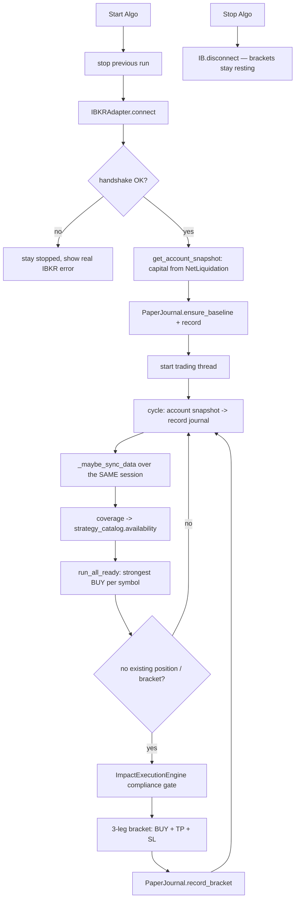

# Architecture — Paper Lab

A deliberately small, **long-only, unleveraged paper-trading lab**. There is one
IB Gateway session, one paper account, one universe table, one journal. Nothing
about the connection is configurable; capital is always read from the account
through the API.

The design principle is **data first**: the tool gathers what the IBKR API can
actually supply, organises it, reports its coverage, and only then exposes
long-only strategies that the stored data can support. Adding a ticker is a
database row, not a code change.

## Fixed session

| | Value |
|---|---|
| Gateway | `127.0.0.1:4002` (paper) |
| Client id | `1` — one connection at a time |
| Market data | delayed, type `3` |
| Take profit / stop loss | `+5%` / `−3%` from the reference price |
| History | `1 Y` of `1 day` bars |
| Min bars for signals | `60` |
| Data stale after | `36 h` |
| Runner auto-sync cooldown | `3600 s` |
| Journal | `data/marketmind.db` |

All of these are plain constants in `marketmind/config.py`, not settings, `.env`
keys, CLI flags or UI inputs. `DEFAULT_UNIVERSE` is only a **seed** — the live
universe is the `instruments` table.

## Module map

```
marketmind/
  config.py                 fixed constants (no settings, no .env)
  ib_compat.py              event-loop bootstrap required by ib_insync on 3.13+
  broker/ib_adapter.py      the ONLY IBKR session: connect, account, contract,
                            history, quotes, brackets, positions, open orders
  compliance/               ImpactExecutionEngine, whitelists, debt/sector rules
  universe.py               instruments table: add / pause / metadata
  market_data.py            MarketDataService: sync, coverage, price_series,
                            manual fundamentals, sync_log, summary
  strategy_catalog.py       StrategySpec catalogue, availability, run, replay
  journal.py                paper_baseline / paper_daily / paper_orders,
                            PnlBreakdown, allocation_of, legacy migration
  data/
    storage.py              SQLite DataStore (thread-local connections)
    models.py               typed snapshots, bars, quotes, fundamentals
  live_trading.py           LiveTradingRunner + CLI
  cockpit/
    app.py                  5-page shell; Overview first
    theme.py                shared CSS, KPI cards, pills, callouts, chart styling
    state.py                process-wide runner state, Start/Stop, refresh, sync
    tabs/                   overview · data_lab · strategies · trading · journal
scripts/
  run_cockpit.py            single cockpit launcher
  ib_connection_probe.py    standalone connect → disconnect → reconnect + bracket
tests/                      unit tests + opt-in live Gateway integration tests
docs/archive/               pre-MVP vision documents (not part of the lab)
```

## One session, two modes

Client id 1 permits exactly one connection. Therefore:

* **Algo stopped** — `state.refresh_snapshot()` and `state.sync_data()` each
  open one short-lived `IBKRAdapter`, do their work, and `disconnect()` in a
  `finally`. Both are disabled while the algo runs.
* **Algo running** — `LiveTradingRunner` owns the session. `_maybe_sync_data()`
  refreshes stale/empty instruments **through that same adapter**, with a
  `DATA_SYNC_COOLDOWN` so a symbol IBKR cannot serve is not retried every 60 s.

The whole `ib_insync` lifecycle is owned by **one dedicated event-loop thread**;
public adapter methods are synchronous/thread-safe via
`asyncio.run_coroutine_threadsafe`. `connect()` always disconnects first; a
graceful `IB.disconnect()` releases client id 1.

## Lifecycle — pressing Start Algo



## Data layer

```
IBKRAdapter (one session)
   ├─ reqContractDetails  ->  contracts + instruments metadata
   ├─ reqHistoricalData   ->  price_bars      (INSERT OR IGNORE, idempotent)
   └─ reqMktData (type 3) ->  market_quotes   (latest delayed bid/ask/last)
                         data_updates        (one audit row per symbol per sync)
                         fundamental_data    (API sector + cockpit-entered ratios)
```

`MarketDataService.sync(adapter, symbols=None)` never aborts the batch because
one symbol fails: each result carries its own status and error, and each gets an
audit row. `_parse_bar_date()` normalises `YYYYMMDD`, `YYYYMMDD HH:MM:SS TZ`,
ISO strings and `date` objects into naive UTC; unparseable bars are dropped
rather than being stamped "now" (which would collide on the primary key).

`coverage()` returns one row per active instrument with bar count, first/last
bar, last close, latest quote, whether a debt ratio exists, last successful sync
and freshness. Status is `ready` (≥ `MIN_BARS_FOR_SIGNALS` and synced within
`DATA_STALE_HOURS`), `partial` or `empty`. `summary()` aggregates it for the
sidebar.

`reqFundamentalData` is **disabled on this paper account (IB error 10358)**.
`MarketDataService.set_fundamental()` therefore writes debt ratios, sector and
market cap from the cockpit into the same `fundamental_data` table the
compliance gate reads. `_ingest_contract()` preserves manual values and never
overwrites them with API metadata.

## Strategy catalogue

`SPECS` declares each rule's `min_bars`, `needs_fundamentals` and family.
`availability(coverage)` reports which rules are runnable *and why the others
are not*. `run_all_ready()` evaluates the ready rules and keeps the strongest
`BUY` per symbol. `replay()` walks a rule over past bars using only data
available on each date, returning BUY dates and forward returns — explicitly
**not** a full backtest (no costs, sizing, TP/SL exits or compliance blocks).

No strategy emits a SELL. Exits are owned by the TP/SL brackets.

## Journal and honest P&L

| Table | Contents |
|---|---|
| `paper_baseline` | one immutable row: original capital / cash / equity / currency, from the API |
| `paper_daily` | one upserted row per UTC day: net liquidation, cash, equity, total change, realized/unrealized/trading/interest P&L, accrued cash, currency, order count |
| `paper_orders` | every bracket: entry / TP / SL order ids and prices, status, note |

`record()` only touches `paper_daily`; it never appends to the legacy
`account_snapshots` / `portfolio_equity` tables.

`PnlBreakdown` separates `total_change` into `trading_pnl` (realized +
unrealized) and `interest_and_other`. A flat paper account earns interest on
idle cash: a `$56.45` rise with zero trades is **interest**, not a phantom gain.
`allocation_of()` uses `GrossPositionValue` as equity and
`NetLiquidation − equity` as cash, so accrued interest correctly stays in cash.

`_migrate()` adds the newer columns to a first-MVP database, backfills
`interest_pnl = pnl_vs_original − trading_pnl` on legacy rows (idempotent), and
`ensure_baseline()` corrects a legacy `currency='USD'` row from a fresh API
snapshot without ever rewriting the immutable original capital.

The raw data browser on the Journal page is read-only.

## Orders

```
BUY parent (market or limit, transmit=False)
  ├─ SELL LIMIT take-profit   ref × 1.05   (parentId, transmit=False)
  └─ SELL STOP  stop-loss     ref × 0.97   (parentId, transmit=True)
```

`ref` is the bid/ask mid, falling back to last / close. No reference price ⇒
submission **fails**, never a naked order. All legs are sanitised for the
Gateway v151 `EtradeOnly` rejection (error 10268). Asset-class classification
reads `WHITELISTED_ETFS` / `WHITELISTED_METALS` from `compliance.rules` — the
single source of truth. Stopping the algo leaves resting brackets at IBKR so
open positions stay protected.

## Cockpit

Five pages sharing `theme.py` (light palette, KPI cards, pills, callouts, empty
states). Price/P&L direction follows the Chinese convention: **up/gains red,
down/losses green**. Money formatting is currency-aware (`€`, `$`, `£`, `¥`),
never a hardcoded `$`.

State is process-wide via `st.cache_resource`; `sync_status()` derives the
displayed status from the real runner on each rerun rather than trusting a
"Running" flag. The shell wraps each page in a `try/except` so a data error
never produces a blank screen.

## Verification

* `pytest tests/` — unit tests (universe, ingestion idempotency, bar-date
  parsing, coverage, strategy gating, replay, P&L breakdown, legacy migration,
  bracket construction, journal cleanliness). No Gateway needed.
* `MARKETMIND_IB_INTEGRATION=1` — opt-in live Gateway tests.
* `scripts/ib_connection_probe.py --all` — connect / disconnect / reconnect,
  data and a cancelled 3-leg bracket.
* Streamlit `AppTest` — all five pages against both an empty and a populated DB.

Runtime databases, `.workbuddy-ai/` state and archives are git-ignored.
