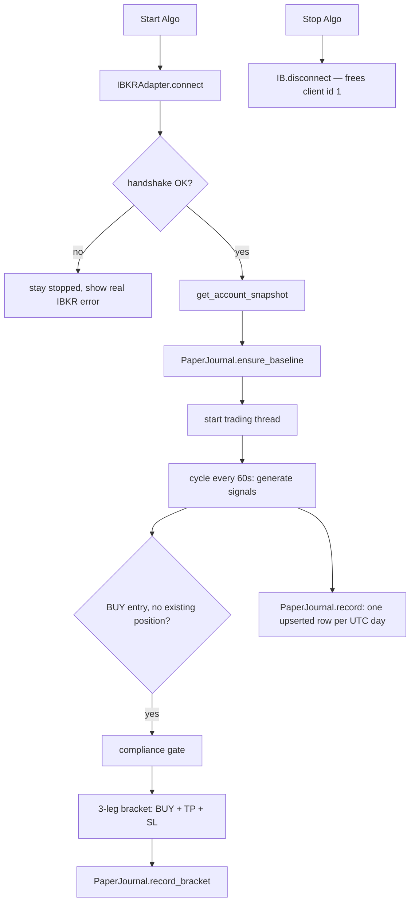

# Architecture — Paper Lab MVP

A deliberately small, **long-only paper-trading lab**. There is one IB Gateway
session, one paper account, one journal. Nothing about the connection is
configurable; capital is always read from the account through the API.

## Fixed session

| | Value |
|---|---|
| Gateway | `127.0.0.1:4002` (paper) |
| Client id | `1` — one connection at a time |
| Market data | delayed, type `3` |
| Take profit / stop loss | `+5%` / `-3%` from the reference price |
| Journal | `data/marketmind.db` |

All of these are plain constants in `marketmind/config.py`, not settings.

## Module map

```
marketmind/
  config.py          fixed constants (no settings, no .env)
  ib_compat.py       event-loop bootstrap required by ib_insync on Python 3.13+
  broker/
    ib_adapter.py    the ONLY IBKR session: connect, account, quotes, brackets
  compliance/        ImpactExecutionEngine gate (screening + validation)
  journal.py         paper_baseline / paper_daily / paper_orders
  data/
    storage.py       SQLite DataStore
    models.py        typed snapshots, bars, fundamentals
    screener.py      data-integrated compliance screening
    ingestion.py     IBKR historical-data pipeline (available, not yet wired in)
    enrichment.py    incremental enrichment helpers (available, not yet wired in)
  strategies.py      signal generation (BUY entries only)
  backtester.py      historical backtests, starting capital from the journal
  live_trading.py    LiveTradingRunner + CLI (python -m marketmind.live_trading)
  cockpit/
    app.py           Streamlit shell; 4 pages, Overview first
    state.py         process-wide runner state, Start/Stop Algo, snapshot refresh
    tabs/            overview · trading · strategies · analytics
scripts/
  run_cockpit.py     single cockpit launcher
  ib_connection_probe.py  standalone connect → disconnect → reconnect + bracket test
tests/               unit tests + opt-in live Gateway integration tests
docs/archive/        pre-MVP vision documents (not part of the lab)
```

## Lifecycle — pressing Start Algo



The whole `ib_insync` session (connect, data, orders, disconnect) is owned by
**one dedicated event-loop thread**. Public adapter methods are synchronous and
thread-safe via `asyncio.run_coroutine_threadsafe`, so Streamlit's script thread
never manages an asyncio loop. `connect()` always disconnects first and makes a
single handshake attempt; a graceful `IB.disconnect()` is what releases client
id 1 for the next run.

## Orders

Every entry is a three-leg bracket built in `broker/ib_adapter.py`:

```
BUY parent (market or limit, transmit=False)
  ├─ SELL LIMIT take-profit   ref × 1.05   (parentId, transmit=False)
  └─ SELL STOP  stop-loss     ref × 0.97   (parentId, transmit=True)
```

`ref` is the bid/ask mid, falling back to last / close. If no reference price is
available, submission **fails instead of sending a naked order**. All legs are
sanitised for the Gateway v151 `EtradeOnly` rejection (error 10268). Stopping
the algo leaves resting brackets at IBKR so open positions stay protected.

## Journal — the single source of truth

| Table | Contents |
|---|---|
| `paper_baseline` | one immutable row: original capital / cash / equity, from the API |
| `paper_daily` | one upserted row per UTC day: net liquidation, cash, equity, P&L, bracket count |
| `paper_orders` | every bracket: entry / TP / SL order ids and prices, status, notes |

`equity = GrossPositionValue` (market value of the long book, `0` when flat) and
`cash = NetLiquidation − equity`. The residual between `NetLiquidation` and
`TotalCashValue` on a flat account is **accrued interest**, not a stock position,
so it stays in cash. `record()` deliberately writes *only* `paper_daily` — it
never appends to the legacy `account_snapshots` / `portfolio_equity` tables.

## Known MVP boundary

The price/fundamental tables are empty after the data cleanup, so a trading
cycle currently produces **0 signals / 0 orders**. `data/ingestion.py` and
`data/enrichment.py` are available to load IBKR history; wiring them into the
signal loop and defining a long-entry strategy is the next step. Bracket
placement itself is verified independently by `scripts/ib_connection_probe.py`.
